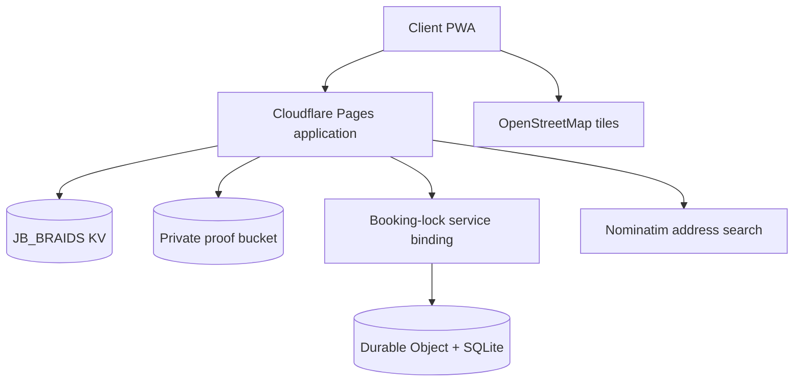

# Architecture notes

## Runtime shape

The application keeps operational data and media separate:

- KV stores bookings, booking indexes, customers, service overrides, availability overrides, loyalty events, sessions and rate-limit windows.
- R2 stores payment proofs. A proof is never published as a public object; the owner receives it only through an authenticated, no-store response.
- The private booking-lock Worker owns the atomic collision and daily-capacity decision. It is reached through a service binding and has no public route.

## Security boundaries

- Production admin access uses a signed, HttpOnly, SameSite=Strict owner session.
- The owner PIN is a Cloudflare secret, never a repository value or client bundle value.
- Replacement PINs are stored as PBKDF2-SHA256 hashes with 210,000 iterations.
- ChatGPT Sites identity headers are accepted only in the trusted Sites runtime. Cloudflare Pages rejects client-supplied versions of those headers.
- Write routes enforce same-origin requests, strict request schemas and conservative body-size limits.
- Upload validation checks actual file signatures instead of trusting file extensions or MIME claims.
- Prices, deposits, chair units, rewards and referrals are calculated server-side.

## Booking consistency

The public availability endpoint gives clients a useful preview, but the final decision is made again at write time. A booking is accepted only when:

1. the date is within the booking window;
2. the day is not blocked;
3. sufficient chair units remain;
4. the requested start remains valid for the selected service and route; and
5. the private Durable Object atomically claims a non-overlapping interval.

If persistence fails after the claim, the claim is released. Cancelling a booking also releases the interval.

## Privacy choices

- The exact home-studio address is shared only after confirmation.
- House and away calls require a Namibia map pin, but the location is stored only with that booking.
- Crown Club lookup requires a matching reference and phone number.
- Admin pages and private proof responses are marked no-store.
