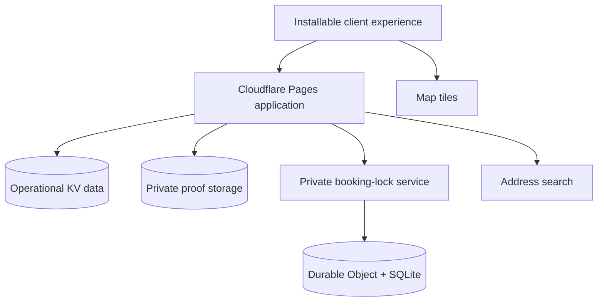

# Architecture notes

> Production scope: these notes describe the monochrome release now live at [jb-braids.pages.dev](https://jb-braids.pages.dev/). Deployment evidence is recorded in the [quality record](QUALITY.md).

## Runtime shape

The public experience, booking API and studio operations share one server-owned domain model while keeping private records and uploaded media behind authenticated routes.

- KV holds booking records and indexes, customers, service overrides, availability overrides, loyalty events, owner sessions and rate-limit windows.
- R2 stores payment proofs as private objects. Proofs are returned only through an authenticated, no-store response.
- A service-bound Durable Object owns the atomic collision and daily-capacity decision. It is not exposed as a public route.

## Booking truth

The availability endpoint gives clients a useful preview, but the final decision is made again when the request is written. A booking is accepted only when:

1. the date is inside the 7–90 day booking window;
2. the day is not blocked;
3. sufficient chair capacity remains;
4. the requested start is valid for the service duration and travel route; and
5. the private lock service atomically claims a non-overlapping interval.

If persistence fails after the claim, the interval is released. Confirmed and proof-submitted bookings retain their claims until they are completed, cancelled or marked as a no-show; those terminal records do not consume active capacity. Provisional unpaid claims are bounded to 24 hours, so abandoned requests cannot reserve a chair indefinitely; the stored booking record remains the source of truth for confirmed work.

## Security and privacy boundaries

- Owner operations require a signed, HttpOnly, SameSite=Strict session and are marked no-store.
- Owner credentials and infrastructure secrets stay in the deployment environment, never the public case study or client bundle.
- Write routes enforce same-origin requests, strict schemas, body-size limits and rate limits.
- Upload validation checks file signatures rather than trusting extensions or declared MIME types.
- Prices, deposits, capacity units, Crown awards and referral credits are calculated on the server.
- The exact home-studio address is shared only after confirmation.
- Callout coordinates belong only to the associated booking.
- Crown Club lookup requires a matching booking reference and Namibian phone number.

## PWA boundary

The service worker is registered globally so every public entry point can become installable. Cache version 11 warms the home, gallery, price list, offline route, local fonts, versioned line-art identity assets and cache-busted share card, and clears previous cache versions during activation.

The `/book` route is intentionally excluded from the offline shell. Booking depends on live availability and a reachable API; presenting a cached, apparently functional request form would be misleading. When the network is unavailable, booking navigation resolves to the branded offline state instead.

## Interface architecture

The information architecture prevents a media-heavy brand from turning into an endless wall:

- `/` is the edited introduction: founder, four signature services, five portfolio moments, one active six-film studio player, selected social proof, popular prices and rewards.
- `/gallery` carries the deliberately ordered 12-look exhibition and direct booking links.
- `/price-list` is a shareable menu and policy reference.
- `/book` is a focused, query-aware journey rather than another home-page section.
- `/admin` is the private operational surface for bookings, proofs, capacity, menu data, clients and rewards.

Progressive reveal effects start from readable content and only hide elements after JavaScript is active. Reduced-motion preferences shorten animation, and mobile navigation locks background scroll while preserving an internally scrollable menu.

Every public route publishes a canonical production URL. Home, gallery, price list and booking publish route-specific Open Graph and Twitter data backed by the cache-busted 1200 × 630 black-and-white line-art launch image, with matching titles, descriptions and canonical destinations.
