  

<h1 align="center">JB.Braids — Wear Your Story</h1>

  A monochrome booking flagship and private studio system for Windhoek hairstylist Jessica Autoni. 
  Editorial discovery, a curated gallery, live booking, client rewards and private owner operations—designed as one unmistakably JB experience.

  <a href="https://jb-braids.pages.dev/"><strong>Enter the live experience ↗</strong></a>
  &nbsp;·&nbsp;
  <a href="https://www.instagram.com/_jb.braids_/">JB.Braids Instagram ↗</a>
  &nbsp;·&nbsp;
  <a href="https://www.instagram.com/jessica_autony/">Meet Jessica ↗</a>
  &nbsp;·&nbsp;
  <a href="https://www.tiktok.com/@jb.braids7">TikTok ↗</a>

  <strong>Now live:</strong> the monochrome release is deployed at the canonical production domain and has completed its post-deployment verification gate.

<table>
  <tr>
    <td width="25%"></td>
    <td width="25%"></td>
    <td width="25%"></td>
    <td width="25%"></td>
  </tr>
</table>

## The brief

JB.Braids began as Jessica’s student hustle in 2022 and grew into a high-demand home studio with a loyal social audience. The business already had the craft, personality and proof. It needed a digital home that could carry that energy while turning a message-heavy booking process into something clearer, safer and easier to run.

The result is not a generic salon template. It is a distinctly African, founder-led editorial system built around Jessica’s real operating rhythm: advance bookings, a verified 50% deposit, only 3–5 clients per day, home-studio privacy, Windhoek house calls, away calls and return-client rewards.

## The creative direction

**Hair as authorship. Booking as choreography.**

The live release pairs a strict black, white and graphite foundation with the natural colour and texture of Jessica’s work. Manrope brings compact clarity to navigation, labels and operational screens; Newsreader adds warmth and fashion-editorial contrast to selected statements. A new one-colour **jB strand monogram** stays legible at app-icon size while still carrying the rhythm of braided sections.

The restraint is intentional: the interface recedes, the hairstyles own the colour, and every dense area is broken into curated previews, horizontal rails, disclosures or dedicated pages rather than one endless wall of content.

## What was built

| Client experience | Studio operations | Trust and resilience |
| --- | --- | --- |
| Curated home edit with dedicated `/gallery` | Authenticated private studio desk | Server-controlled pricing, totals and 50% deposit |
| Complete `/price-list` and focused `/book` journey | Booking, status and proof workflow | Atomic collision and daily-capacity protection |
| 7–90 day availability calendar | Calendar capacity and blocked days | Namibia-only phone validation |
| Home-studio, house-call and away-call routes | Service pricing and duration editor | Strict origin, schema and upload validation |
| Windhoek address search and map pin | Crown Club and referral ledger | Private payment-proof storage |
| Optional colour, prep, reference and custom-request details | Founder-specific embedded operating guide | 24-hour provisional unpaid hold |
| Crown Club return-client rewards | Mobile-first booking management | Installable PWA with truthful offline handling |

## Jessica is part of the brand

The live experience gives the founder a visible role instead of hiding her behind a business handle. Jessica appears in the hero, a dedicated founder story and structured business identity, with a direct route to [her personal Instagram](https://www.instagram.com/jessica_autony/). Her portrait and the JB.Braids portfolio are used with permission.

That presence matters: clients are not only choosing a hairstyle. They are trusting a person, her taste and her hands.

## Social proof became product content

JB.Braids’ public Instagram and TikTok work was treated as evidence, not decoration. The public experience separates a tight home edit from the complete gallery, switches between selected video and Instagram collections, and links back to Jessica’s original channels.

This keeps the site anchored in real work without forcing every visitor to scroll through every asset before they can understand the offer or book.

## The booking system

```mermaid
flowchart LR
    A[Choose a look] --> B[Choose studio or callout]
    B --> C[Live date and time availability]
    C --> D[Client details and optional requests]
    D --> E[Server recalculates total and 50% deposit]
    E --> F[Atomic slot claim]
    F --> G[24-hour provisional payment window]
    G --> H[Jessica verifies and confirms]
    H --> I[Completed visit earns a Crown]
```

Services with longer chair times consume more daily-capacity units, overlapping appointments cannot be claimed twice, and expired unpaid requests stop reserving capacity after 24 hours. Completed, cancelled and no-show requests are excluded from active capacity. Clients never control their own price, deposit or reward totals.

Gallery and menu choices deep-link into `/book?service=…`, so the selected look arrives prefilled. Colour, beads, prep, takedown, email, referral and custom-request fields remain available behind clear optional disclosures rather than lengthening everyone’s first pass.

## Crown Club

Each completed appointment adds one Crown. On the fourth completed appointment, the server converts four Crowns into **N$150 of recorded service credit** for a future service. The booking form does not automatically spend that credit or reduce the required deposit. Referral credits are ledger-backed and awarded only after the referred client’s first completed appointment.

The public lookup requires both a booking reference and the matching Namibian phone number; it does not expose client information from a reference alone.

## Platform

The public site and server-rendered application run on Cloudflare Pages. Operational records use Cloudflare KV, payment proofs are private in R2, and a service-bound Durable Object provides the atomic booking lock that prevents collision and daily-capacity races.

The installable PWA caches the discovery shell and assets, but the booking desk is deliberately live-only. An offline visitor receives a clear reconnect state instead of a stale form that appears able to submit.

The production implementation remains private. This repository is a portfolio-safe design and engineering case study.

## Release quality

The deployed monochrome release passed lint, TypeScript, production-mode build, current-tree route/PWA/asset probes and the final production contract: **110 passed · 0 failed**. Live visual smoke review covered 1440 × 900 desktop and 390 × 844 mobile, with additional pre-deployment reviews at 360 × 800 and 320 × 568. An isolated synthetic production run was fully cleaned, and aggregate post-clean verification found no booking, customer, loyalty or proof artifacts remaining.

See the [quality record](QUALITY.md) and [architecture notes](ARCHITECTURE.md) for the evidence boundary and system design.

## Credits

**[Jessica Autoni](https://www.instagram.com/jessica_autony/)** — Founder, stylist and creative subject 
**JB.Braids** — Original hair work, images and social content 
**SolarSpin Technologies** — Brand direction, experience design, engineering and launch

Built in Windhoek, Namibia. 
[A Digital Experience by SolarSpin Technologies](https://solarspin-namibia.pages.dev/)

---

All JB.Braids brand assets, photography and client imagery are used with permission and remain the property of their respective owners. This public repository is a portfolio case study, not an open-source distribution of the production application.
