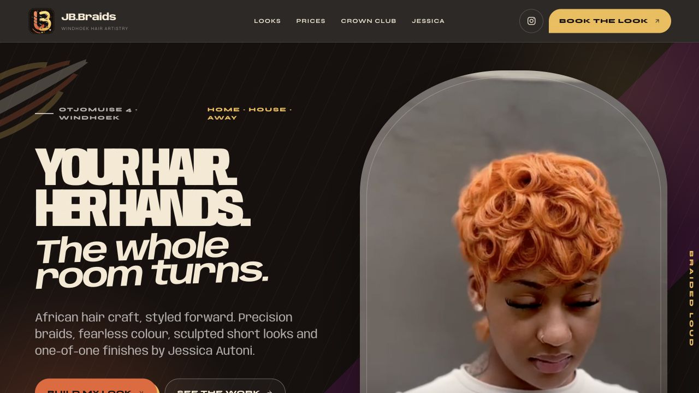

  

<h1 align="center">JB.Braids — Wear Your Story</h1>

  A booking-first digital flagship for Windhoek hairstylist Jessica Autoni. 
  Brand world, live pricing, callout concierge, loyalty engine and private studio operations—built as one experience.

  <a href="https://jb-braids.pages.dev/"><strong>Enter the live experience ↗</strong></a>
  &nbsp;·&nbsp;
  <a href="https://www.instagram.com/_jb.braids_/">Instagram ↗</a>
  &nbsp;·&nbsp;
  <a href="https://www.tiktok.com/@jb.braids7">TikTok ↗</a>

## The brief

JB.Braids began as Jessica’s student hustle in 2022 and grew into a high-demand home studio with a loyal social audience. The business already had the work, the personality and the proof. What it needed was a digital experience that could carry that energy while replacing a fragile, message-heavy booking process.

The result is not a generic salon template. It is a distinctive African editorial system built around Jessica’s actual client rhythm: advance bookings, a verified 50% deposit, only 3–5 clients per day, home-studio privacy, Windhoek house calls, away calls and repeat-client rewards.

## The idea

**Hair as authorship. Booking as choreography.**

The design language combines woven forms, sharp display typography, tactile paper, warm mineral colour, image-led storytelling and responsive motion. Every screen is composed to feel alive without making the booking flow harder to understand.

<table>
  <tr>
    <td width="33%"></td>
    <td width="33%"></td>
    <td width="33%"></td>
  </tr>
</table>

## What was built

| Client experience | Studio operations | Trust and resilience |
| --- | --- | --- |
| Editorial mobile-first portfolio | Private owner-PIN admin desk | Server-controlled pricing and totals |
| Live service menu and modifiers | Booking and deposit-proof workflow | Atomic collision and capacity protection |
| 7–90 day availability calendar | Calendar capacity and blocked days | Namibia-only phone validation |
| Home, house-call and away-call routes | Service pricing and duration editor | Strict origin, schema and upload checks |
| Windhoek address search and map pin | Crown Club and referral ledger | Private R2 payment-proof storage |
| FNB, Bank Windhoek, wallet, EFT and cash-deposit paths | Built-in Jessica operating guide | Rate limits, security headers and no-store admin data |
| Crown Club return-client rewards | Protected 12-hour owner sessions | Installable PWA and offline route |

## Social proof became product content

The public Instagram profile was expanded and reviewed through all **24 visible reels**, reaching back to 25 June 2026. Twelve varied looks were curated into a living editorial gallery. Five high-performing TikTok looks were given their own motion rail, with direct links back to Jessica’s original posts.

This keeps the site anchored in real work instead of stock imagery or invented portfolio pieces.

## The booking system

```mermaid
flowchart LR
    A[Choose a look] --> B[Choose studio or callout]
    B --> C[Live date and time availability]
    C --> D[Client details and custom notes]
    D --> E[Server recalculates total and 50% deposit]
    E --> F[Atomic slot claim]
    F --> G[Payment proof or cash arrangement]
    G --> H[Jessica verifies and confirms]
    H --> I[Completed visit earns a Crown]
```

Longer looks consume more chair units, overlapping appointments cannot be claimed twice, and cancelled requests release their booking window. Clients never control their own price, deposit or reward totals.

## Crown Club

One completed appointment earns one Crown. Four Crowns unlock **N$150 service credit** for visit five. Referral rewards are ledger-backed and awarded only after the referred client’s first completed appointment.

The public lookup requires both a booking reference and the matching Namibian phone number; it does not expose customer information from a reference alone.

## Platform

The public site and server-rendered application run on Cloudflare Pages. Operational records use Cloudflare KV, payment proofs are private in R2, and a service-bound Durable Object provides the atomic booking lock that prevents collision and daily-capacity races.

The implementation source remains private. This repository is the public design and engineering case study.

## Release quality

The production-equivalent suite completed **65 checks with 0 failures**. The live release then passed a separate smoke test covering the production owner session, forged-header rejection, real slot creation, duplicate blocking, cancellation, slot release and clean removal of QA data.

See [Quality record](QUALITY.md) and [Architecture notes](ARCHITECTURE.md).

## Credits

**Jessica Autoni** — Founder, stylist and creative subject 
**JB.Braids** — Original hair work, images and social content 
**SolarSpin Technologies** — Brand direction, experience design, engineering and launch

Built in Windhoek, Namibia. 
[A Digital Experience by SolarSpin Technologies](https://solarspin-namibia.pages.dev/)

---

All JB.Braids brand assets, photography and client imagery are used with permission and remain the property of their respective owners. This public repository is a portfolio case study, not an open-source distribution of the production application.
